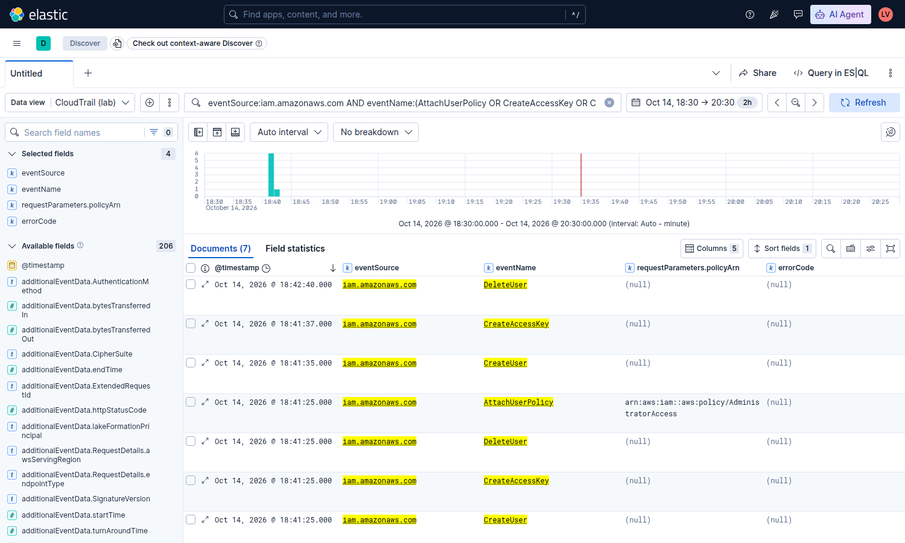
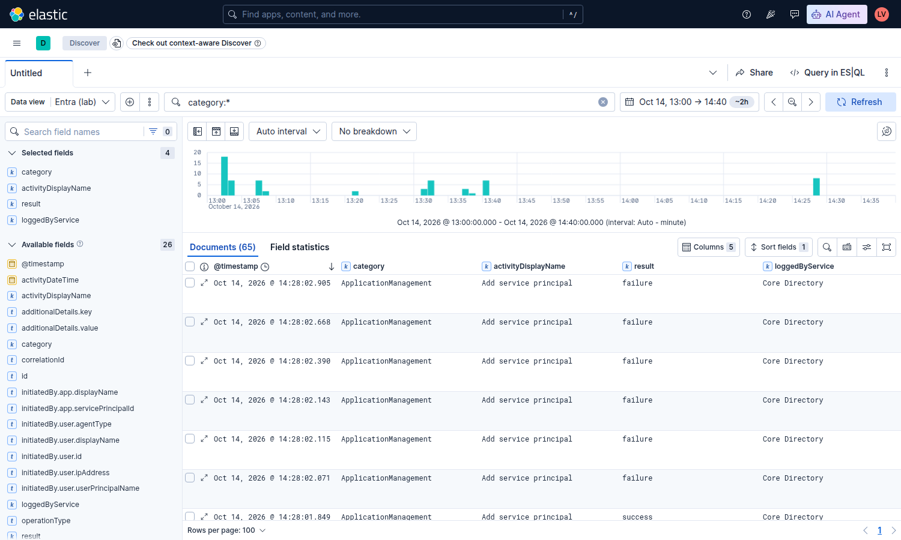
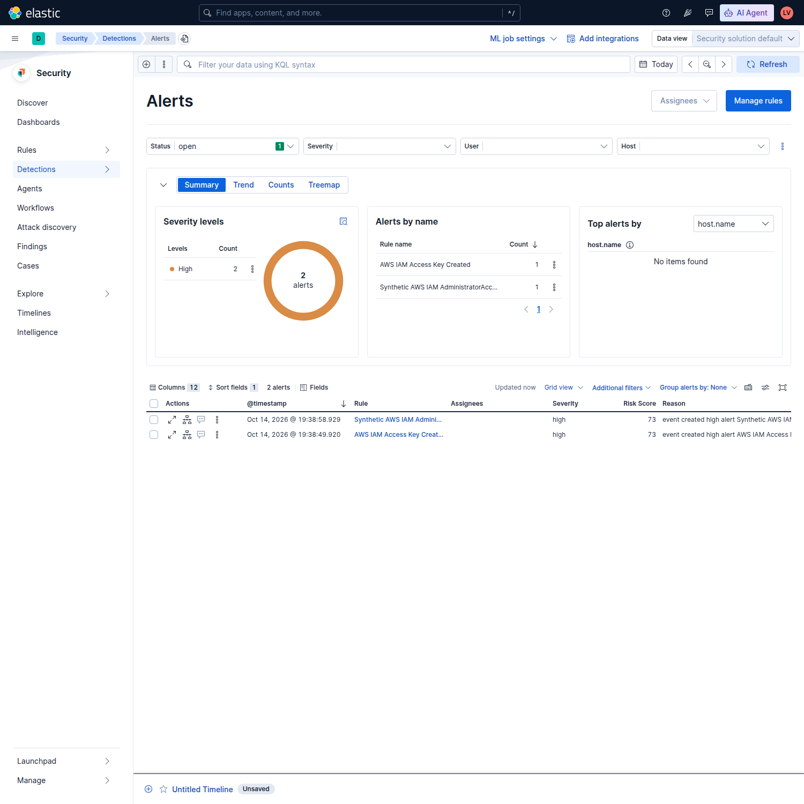

# Building a cloud-response lab, validated on real logs

**Status: partial, and honest about it.** Detection logic is proven end to end on real cloud telemetry for 2 of 8 rules. The other 6 are tested only against fixtures. Response automation is dry-run only. Nothing here is a finished SOC.

## At a glance

| Question | Answer, with proof |
|---|---|
| Real telemetry loaded? | Yes. 1,266 real AWS CloudTrail events (2026-10-14 13:52Z to 19:36Z) and 65 real Entra directory audit events (13:02Z to 14:28Z). Personal sandbox accounts only. |
| Real attacks run? | Yes. Stratus Red Team v2.37.0, IAM-only, no-cost techniques. See below. |
| Detections fired on real events? | Yes: the AdministratorAccess rule matched 3 real events and the access-key rule matched 4. |
| Did the scheduler fire alerts by itself? | Yes, for events inside the rule lookback window: 2 alerts, created 14 to 23 seconds after the events were indexed. |
| Response automation? | Staged workflows executed in dry-run only. No automated action was ever taken against an account. |
| Unproven | Entra sign-in logs, 6 of 8 rules on real data, continuous ingestion, HTTPS. See "Not proven". |

## What ran

**Data.** CloudTrail objects were pulled from the sandbox account's S3 bucket with boto3 and bulk-loaded into a private Elasticsearch 9.5.5. The loader is idempotent: the document id is the CloudTrail event id, so reruns update rather than duplicate. Of 1,269 records, 3 were rejected for field-type conflicts in unrelated services' request parameters. Entra audit logs came from Microsoft Graph (client credentials).

**Attack simulation.** Stratus Red Team v2.37.0, three IAM-only detonations, each followed by cleanup:

- aws.persistence.iam-create-admin-user at 18:41Z and again at 19:32Z
- aws.persistence.iam-backdoor-user at 18:41Z

After cleanup, an IAM re-list showed only the lab user with one access key, and Stratus reported every technique as COLD. One cleanup needed manual repair: the first backdoor-user teardown was denied `iam:DeleteLoginProfile` for the lab user, so the leftover IAM user was deleted directly and the teardown was rerun.

**Detections on real data (manual query against the real index).**

| Rule | Real hits | Event ids (first 8) |
|---|---|---|
| IAM AdministratorAccess policy attached | 3 | af37c58b, 383a748d, be7e93aa |
| IAM access key created | 4 | fe383fb3, 633a461a, 31e5b6af, 995abdf7 |
| Console login without MFA | 0 | none |
| CloudTrail logging stopped | 0 | none |
| CloudTrail trail deleted | 0 | none |

Zero hits means no matching event in this window. It is not evidence that those rules work.

**Scheduler proof.** Both matching rules were enabled in Kibana. A rule that merely exists proves nothing, so the check was whether the scheduler would alert without a manual query. The first attempt produced zero alerts: the rules looked back only 10 minutes, and the events were older than that by the time the rules were enabled. The lookback was widened to 30 minutes, because CloudTrail delivery and ingestion lag the event. A fresh simulation was then run at 19:32:04Z. The events were indexed at 19:38:36Z and the scheduler created two alerts on its own, at 19:38:49.920Z and 19:38:58.929Z (high severity, risk score 73). Evidence: [auto-alerts-redacted-20261014.json](evidence/auto-alerts-redacted-20261014.json).

The 406 and 415 second figure between event time and alert time is mostly CloudTrail delivery plus a manual ingest. It is not detection latency. Detection latency, from indexing to alert, was 14 to 23 seconds.

**Triage of the two unexplained early matches.** The 13:58:54Z AttachUserPolicy and 13:59:54Z CreateAccessKey matches predate the simulation. The raw events show a console session (no MFA) on an administrator role creating the lab's IAM user, attaching AdministratorAccess to it, and a minute later creating its access key. That key is the one the simulation later used. Verdict: expected lab bootstrap, and the rule worked as designed. It is also a real finding: the lab identity holds AdministratorAccess and was created from a session without MFA. Least privilege is the fix.

## Screenshots

All three were captured with a read-only account and checked for account ids, addresses and emails before publication.

Real CloudTrail events from the simulation (CreateUser, AttachUserPolicy, CreateAccessKey, DeleteUser at 18:41Z to 18:42Z).

The 65 real Entra audit events. None match the three Entra rules.

The two alerts the scheduler created on its own.

## ATT&CK coverage map

Technique ids come from the generated matrix in `library/generated/matrix.json`. Layer file: [navigator.json](../library/generated/navigator.json).

| Technique | Tactic | Rule | Provider | Status on real data |
|---|---|---|---|---|
| T1098.003 Additional Cloud Roles | Persistence, Privilege Escalation | aws-admin-attachment | AWS | Matched 3 real events. Scheduler alert proven. |
| T1098.001 Additional Cloud Credentials | Persistence | aws-access-key-create | AWS | Matched 4 real events. Scheduler alert proven. |
| T1562.008 Disable or Modify Cloud Logs | Defense Evasion | aws-cloudtrail-stop | AWS | Fixture only. Not simulated: it would touch the trail. |
| T1562.008 Disable or Modify Cloud Logs | Defense Evasion | aws-cloudtrail-delete | AWS | Fixture only. Not simulated. |
| T1078.004 Cloud Accounts | Defense Evasion, Persistence, Privilege Escalation, Initial Access | aws-console-no-mfa | AWS | Fixture only. No console login in the window. |
| T1098.003 Additional Cloud Roles | Persistence, Privilege Escalation | entra-role-member | Entra | Real data loaded, 0 matches. Fixture only. |
| T1098.001 Additional Cloud Credentials | Persistence | entra-app-credential | Entra | Real data loaded, 0 matches. Fixture only. |
| T1556.009 Conditional Access Policies | Credential Access, Defense Evasion, Persistence | entra-conditional-access-delete | Entra | Real data loaded, 0 matches. Fixture only. |

**Real-data coverage: 2 of 8 rules.** The other 6 have fixture coverage only, and 3 of those have real Entra data loaded that simply contains nothing matching. These are behavioural mappings, not adversary attribution or a coverage percentage. Authorized changes can fire. Missing logs and alternate operation names can miss.

## What the library adds

Eight genuine Sigma YAML rules (five AWS CloudTrail, three Entra audit). The compiler produces disabled Lucene rules with provider-separated indices, a deterministic matrix and a Navigator layer. Ten positive and 71 negative generated cases exercise a bounded pySigma AST test oracle, and independent fixed operation contracts prevent silent selection drift. Every rule has an individual unit test and an offline dry-run response contract. The suite runs 73 tests in normal and optimized modes in continuous integration.

## Engineering lessons

- A compiler passing is not a query engine agreeing. Parity had to be shown against real Elasticsearch, and only 2 rules have been.
- Lookback has to exceed delivery lag. A rule with a 10 minute window never saw events that CloudTrail delivered minutes late. Widening it to 30 minutes is what made the scheduler alert.
- A rule that merely exists proves nothing. The first scheduler check returned zero alerts, which exposed that the earlier "match" was a manual query.
- Check your own style linter against files you do not own. The first hosted CI run failed because a validator rejected pre-existing partner files that lacked trailing newlines.
- Cleanup needs verifying, not trusting. A teardown can fail on a permission the simulation needs, and only an IAM re-list shows what was left behind.
- Gate any screenshot automation on a text check. One capture silently fell back to the wrong data view and exposed an account id in its rows. It was caught and deleted before it was committed, and the script now refuses to save a page that shows a 12-digit id, an address or an email.
- Direct API response is not orchestration. A workflow export is not execution evidence.
- Terraform output manifests are not provisioning. The module is provider-free and plan-only. It now passes `fmt`, `validate` and `plan` on Terraform 1.16.6, and creates no resources.

## Not proven

- **Entra sign-in logs.** Microsoft Graph refuses them with `Authentication_RequestFromNonPremiumTenantOrB2CTenant`. The tenant has no Entra P1 or P2 licence, so only directory audit logs are loaded.
- **6 of 8 rules on real data**, as listed above.
- **Continuous ingestion.** Loading is a manual, idempotent script. A scheduled pipeline would need long-lived cloud credentials on the lab host, which is a separate decision.
- **Response automation.** Shuffle workflows ran in dry-run only. Shuffle's backend mounts the Docker socket, which is root-equivalent on the host. Access is restricted to the private network, concurrency is capped at 2, and workflows stay dry-run.
- **HTTPS.** Kibana and Shuffle are served over plain HTTP on a private WireGuard network and are not reachable from the public internet.
- **Branch protection and a genuine second-owner review** are not in place on this repository.
- **Live rules differ from the repo.** The two enabled Kibana rules use a 30 minute lookback. The generated rules in this repository use 10 minutes.

Follow the [12-week guide and lifecycle gates](BUILD-GUIDE.md). Next: query-engine parity for the remaining rules in a separately authorized bounded run, and sign-in telemetry once a licence exists. No provider credential, private host address, private path or secret belongs in portfolio evidence.
