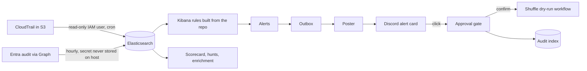

# A cloud detection and response lab on real logs

**Status: working end to end, partial overall.** AWS CloudTrail and Entra directory-audit logs from personal sandbox accounts flow into Elasticsearch on a schedule, repo-defined rules alert on them, and a Discord console turns alerts into approval-gated, dry-run response. Five of the eleven live rules have matched real events; the other six are tested on fixtures only. Nothing in the response path can change an account. This page says what was measured and what was not.

## At a glance

| Question | Answer, with proof |
|---|---|
| Real telemetry? | Yes. As of 2026-10-14 20:50Z: 1,315 CloudTrail and 65 Entra directory-audit documents, loaded on a schedule. Personal sandbox accounts only. |
| Does it run without a person? | Yes. A fresh attack simulation at 20:45:20Z produced Discord alert cards at 20:52:04Z to 20:52:09Z, 6 min 44 s later, with no manual step. See the timeline below. |
| Do detections work on real events? | Five of eleven rules matched real events. See the table. |
| Is deployed equal to the repo? | Yes. Rule lookback, interval, severity and enabled state come from `core/config.json` and each pack's `pack.json`; a drift check found differences before the first deploy and none after. |
| Can the response change anything? | No. Every playbook is dry-run: the AWS response identity holds no destructive permission and the Azure app holds read-only Graph scopes. |
| Tests | 153 (76 platform, 54 pack, 23 console), run in normal and optimized mode in CI. 28 playbook UAT cases pass. |
| Not proven | Discord button clicks and slash commands (not yet used by a person), sign-in detections, six rules on real data, HTTPS, branch protection. See the end. |



## Packs: how the lab grows

Each log source is a self-contained pack:

```
packs/<name>/
  pack.json          field mapping for cards, Kibana data view, action buttons, enabled rules
  detections/        Sigma rules
  playbooks/         response as code (JSON) + the generated Shuffle workflow beside each
  tests/             two-line test modules that use the shared kit in core/testkit.py
  attack-layer.json  generated ATT&CK Navigator layer
  README.md
core/                the platform: console, approval gate, playbook runner, CI report, metrics, deploy
```

Adding a lab means adding `packs/<name>/` with that shape. The console, CI and metrics read `pack.json` and need no code change; a test builds an alert card for a made-up cloud to prove it. Two packs exist (AWS, Entra). Rule counts: AWS 5, Entra 6 live plus 3 fixture-only.

## What ran

**Data.** A scheduled loader pulls the last two days of CloudTrail objects every ten minutes and loads them idempotently (document id = CloudTrail `eventID`). It uses a dedicated IAM user that can only list and read the trail prefix. Checked against that policy: listing and reading the trail succeed; writes, deletes, listing other prefixes or buckets, and IAM, CloudTrail and EC2 calls are all denied (2 allowed, 8 denied). The attack-simulation identity is never used for ingestion. Entra audit logs are pulled hourly by a gateway-side script that pipes the Azure secret over SSH to a temp file the loader deletes first, so the secret is never stored on the lab host. A few documents per run are rejected for field-type conflicts in unrelated services' request parameters (3 of 1,318 on the latest run).

**Attack simulation.** Stratus Red Team v2.37.0, IAM-only techniques with cleanup, three detonations (18:41Z, 19:32Z, 20:45Z). After each, an IAM re-list showed no leftover principal. The attack-simulation IAM user is **intentionally privileged**, because Stratus needs those permissions; it was created from a console session without MFA, and that is recorded as a finding.

## Detections on real data

| Rule | ATT&CK | Real matches (queried against the live index) |
|---|---|---|
| AWS IAM access key created | T1098.001 | 6 |
| AWS IAM AdministratorAccess attached | T1098.003 | 4 |
| Entra app role assigned to a service principal | T1098.003 | 2 |
| Entra application consent or delegated grant | T1528 | 2 |
| Entra new user created | T1136.003 | 1 |
| AWS console login without MFA, CloudTrail logging stopped, CloudTrail trail deleted | T1078.004, T1562.008 | 0 (fixtures only) |
| Entra app credential added, role member added, conditional access policy deleted | T1098.001, T1098.003, T1556.009 | 0 (fixtures only) |
| Entra MFA fatigue, impossible travel, brute force | T1621, T1078.004, T1110 | fixture only: sign-in logs need Entra ID P1 or P2 |

Zero matches means no such event has happened in the data, not that the rule works. The Entra matches are historical events from setting up the app registration; they are older than the rule lookback, so they match the query but did not alert.

## Unattended proof

Times are UTC on 2026-10-14. Nobody touched anything between the first and last row.

| Time | Step |
|---|---|
| 20:45:20 | Stratus detonation (create admin user, attach AdministratorAccess, create key, clean up) |
| 20:50:08 | Scheduled loader pulled the new CloudTrail objects |
| 20:50:49, 20:50:58 | Scheduled rules alerted (access key created, AdministratorAccess attached) |
| 20:52:04 to 20:52:09 | Alert cards, each with its button card, posted to Discord |

The 6 min 44 s from event to card is mostly CloudTrail delivery plus the loader's ten-minute cadence. It is not detection latency. A third alert in the same run was for the creation of the loader's own read-only IAM user at 20:42:30: the pipeline detected a real change made while building it.

## Response as code

Four playbooks are versioned files with a Shuffle workflow generated from each: `contain-iam-user` (AWS) and `disable-service-principal`, `revoke-sessions`, `reset-mfa` (Entra). For every playbook, tests assert that it acts only on matching events, halts for approval before any change, does nothing on benign events, and writes an audit record for every outcome including refusals. Confirming one runs a real Shuffle execution (three nodes, all successful) that only echoes a simulated record. In the live check, an unauthorised confirm was refused, a confirm from an approver ran the workflow and printed its audit line, and a second confirm was refused.

## Screenshots

Captured with a read-only account and checked for identifying data before publication. They show the first run's two alerts.


## ATT&CK coverage map

Per-pack layers: [AWS](../packs/aws/attack-layer.json), [Entra](../packs/entra/attack-layer.json). Green is an enabled rule on a live source, grey is fixture only.

| Technique | Pack | Rules | Status |
|---|---|---|---|
| T1098.001 Additional Cloud Credentials | AWS, Entra | access key created; app credential added | enabled; the AWS rule has real matches |
| T1098.003 Additional Cloud Roles | AWS, Entra | admin attached; app role assigned; role member added | enabled; real matches on two |
| T1562.008 Disable or Modify Cloud Logs | AWS | logging stopped; trail deleted | enabled; no real event, not simulated because it would touch the trail |
| T1078.004 Cloud Accounts | AWS, Entra | console login without MFA; impossible travel | AWS enabled with no real event; Entra fixture only |
| T1528 Steal Application Access Token | Entra | consent granted | enabled; real match |
| T1136.003 Create Account: Cloud Account | Entra | new user created | enabled; real match |
| T1556.009 Conditional Access Policies | Entra | CA policy deleted | enabled; no real event |
| T1110 Brute Force, T1621 MFA Request Generation | Entra | sign-in rules | fixture only |

These are behavioural hypotheses, not a coverage percentage. Authorized changes can fire; missing logs and other operation names can miss.

## Engineering lessons

- A rule that merely exists proves nothing. The first scheduler check returned zero alerts because the rules looked back 10 minutes and CloudTrail delivers later. Lookback is now one config value, and a drift check compares the repo with Kibana.
- Redaction needs its own tests. The first version masked the last group of GUIDs as if they were account ids, which would have corrupted event ids on every card; a regression test now pins that.
- Run it against real services before believing it. Live use found a text-mapped field that broke an aggregation, a hunt verdict that claimed a rule had not fired when it had, a link Discord rejected because of unencoded quotes, and a test runner that printed progress into JSON output. Each has a test.
- A screenshot script needs a text gate. One capture silently showed the wrong data view and exposed an account id; it was caught and deleted before commit, and the script now refuses pages showing an id, an address or an e-mail.
- Cleanup needs verifying, not trusting. A teardown can fail on a permission the simulation needs; only an IAM re-list shows what is left.

## Not proven

- **Discord button clicks and slash commands.** The cards render with their buttons and the handlers are built and tested against live services, but no person has clicked a button or typed a slash command yet. Native slash-command registration happens on a gateway restart.
- **Sign-in detections.** Microsoft Graph refuses sign-in logs with `Authentication_RequestFromNonPremiumTenantOrB2CTenant`: the tenant has no Entra ID P1 or P2 licence, and no trial was started because it can bill.
- **Six of eleven rules on real data**, listed above.
- **Live containment.** Out of scope by design: the response identity and the Azure app lack write permissions, and the playbook files list what each would need.
- **Alert-to-card latency under load,** and Discord delivery if the outbox backs up. Retries are bounded and a stuck entry is reported in `/lab_status`.
- **HTTPS.** Kibana and Shuffle run over plain HTTP on a private WireGuard network and are not reachable from the public internet. Shuffle can reach the host's Docker socket, which is root-equivalent; access is restricted, concurrency is capped at 2, and workflows stay dry-run.
- **Branch protection and an independent second-owner review** are not in place on this repository.

See [docs/CONSOLE.md](CONSOLE.md) to operate it and [docs/BUILD-GUIDE.md](BUILD-GUIDE.md) for the build-along. No provider credential, private host address, private path or secret belongs in portfolio evidence.
